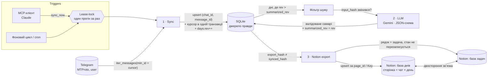

# Telegram MCP-конектор для «другого мозку»

MCP-сервер підключається до Telegram (групи та особисті чати) від імені користувача. Він **інкрементально** забирає нові повідомлення, за допомогою LLM робить **короткі денні самарі** без шуму і публікує їх у **Notion**. Повторні, пропущені й подвійні запуски безпечні: дублів не буде, повідомлення не загубляться.

```
Telegram ──(тільки id > курсор)──► SQLite ──(змінені дні)──► фільтр шуму ──► LLM (JSON-схема) ──► SQLite ──(змінені самарі)──► Notion
```

---

## Зміст
1. [Що вміє](#що-вміє)
2. [Запуск крок за кроком](#запуск-крок-за-кроком)
3. [Розгортання на сервері (24/7)](#розгортання-на-сервері-247)
4. [Як це виглядає в Notion](#як-це-виглядає-в-notion)
5. [Командний бот у групах (понад вимоги)](#командний-бот-у-групах-понад-вимоги)
6. [Схема потоку даних](#схема-потоку-даних)
7. [Ядро синхронізації: чому немає дублів і пропусків](#ядро-синхронізації-чому-немає-дублів-і-пропусків)
8. [LLM-самарі та відсів шуму](#llm-самарі-та-відсів-шуму)
9. [Секрети та чутливі дані](#секрети-та-чутливі-дані)
10. [Рішення та trade-offs](#рішення-та-trade-offs)
11. [Обмеження](#обмеження)
12. [Тести та демо](#тести-та-демо)
13. [Структура проєкту](#структура-проєкту)

---

## Що вміє

**MCP-інструменти** (stdio-транспорт, працює з Claude Desktop / Claude Code / будь-яким MCP-клієнтом):

| Інструмент | Що робить |
|---|---|
| `tg_list_chats(query?, limit?)` | список чатів (DM, групи, канали) з id; позначає, які відстежуються |
| `tg_read_messages(chat_id, limit?)` | останні повідомлення чату напряму з Telegram |
| `tg_send_message(chat_id, text)` | надіслати повідомлення (за замовчуванням лише у відстежувані чати; вимикається `READ_ONLY=true`) |
| `tg_track_chat(chat_id, include_history?)` / `tg_untrack_chat(chat_id)` | вибір чатів для синхронізації (нічого не синхронізується без явного вибору). `include_history=false` підключає чат «з цього моменту»: його історія ніколи не читається |
| `sync_now()` | синхронізація → самарі → Notion; ідемпотентно, повертає звіт прогону |
| `sync_status()` | курсори, помилки, черга днів, останні прогони, розклад |
| `get_summaries(chat_id?, date_from?, date_to?)` | збережені денні самарі |

**Періодичність:** поки MCP-сервер запущений, фоновий цикл робить прогін одразу після старту (догоняє все пропущене) і далі кожні `SYNC_INTERVAL_MINUTES`. Незалежно від Claude те саме робить `uv run tg-connector sync` з cron/launchd. Обидва способи можна вмикати одночасно: їх розводить спільне блокування.

**CLI** (`uv run tg-connector …`): `login`, `check`, `chats`, `track`, `untrack`, `sync`, `status`, `summaries`, `serve`, `bot`.

---

## Запуск крок за кроком

### 0. Що потрібно
- macOS / Linux, [uv](https://docs.astral.sh/uv/) (сам встановить Python 3.12).
- Акаунт Telegram, Google-акаунт (Gemini), робочий простір Notion.

```bash
git clone https://github.com/mitnikovaola-afk/telegram-mcp-connector.git && cd telegram-mcp-connector
uv sync
cp .env.example .env && chmod 600 .env
```

### 1. Ключі (вставляються лише у `.env`)
| Змінна | Де взяти |
|---|---|
| `TG_API_ID`, `TG_API_HASH` | [my.telegram.org](https://my.telegram.org) → *API development tools* → створити застосунок |
| `GEMINI_API_KEY` | [aistudio.google.com](https://aistudio.google.com) → *Get API key* → *Create API key*. Безкоштовний тариф, billing **не** підключати |
| `NOTION_TOKEN` | [notion.so/profile/integrations](https://www.notion.so/profile/integrations) → *New integration* (Internal) → *Internal Integration Secret* |
| `NOTION_PARENT_PAGE_ID` | посилання на сторінку, де зʼявиться база самарі. На сторінці: **••• → Connections → ваша інтеграція** |
| `TG_BOT_TOKEN` | *опційно, лише для [командного бота](#командний-бот-у-групах-понад-вимоги):* [@BotFather](https://t.me/BotFather) → `/newbot` → токен |

### 2. Вхід у Telegram (один раз, інтерактивно)
```bash
uv run tg-connector login      # телефон → код з Telegram → (пароль 2FA, якщо є)
uv run tg-connector check      # перевіряє Telegram, Gemini (і що модель доступна), Notion
```

### 3. Вибір чатів і перший прогін
```bash
uv run tg-connector chats -q маркет          # знайти id чату
uv run tg-connector track -1001234567890 42  # групу та DM (з історією за BACKFILL_DAYS)
uv run tg-connector track 42 --from-now      # або без історії: лише повідомлення, написані після цієї команди
uv run tg-connector sync                     # синхронізація → самарі → Notion
uv run tg-connector sync                     # повтор: 0 нових, 0 LLM-викликів, 0 змін у Notion
```
Під час першого прогону в Notion сам створюється «другий мозок» із двох повʼязаних баз і готових видів (див. [«Як це виглядає в Notion»](#як-це-виглядає-в-notion)).

### 4. Підключення до Claude
**Claude Desktop** → *Settings → Developer → Edit Config* (`claude_desktop_config.json`):
```json
{
  "mcpServers": {
    "telegram": {
      "command": "/Users/<you>/.local/bin/uv",
      "args": ["--directory", "/absolute/path/to/telegram-mcp-connector", "run", "tg-connector", "serve"]
    }
  }
}
```
**Claude Code:**
```bash
claude mcp add telegram -- uv --directory /absolute/path/to/telegram-mcp-connector run tg-connector serve
```
Приклади запитів: *«Покажи мої чати з "маркет"»*, *«Відстежуй цей чат»*, *«Синхронізуй і покажи самарі за вчора»*.

### 5. (Опційно) синхронізація без відкритого Claude
```bash
# crontab -e
*/30 * * * * cd /absolute/path/to/telegram-mcp-connector && ~/.local/bin/uv run tg-connector sync >> data/logs/cron.log 2>&1
```
Cron на ноутбуці працює, лише поки компʼютер увімкнений і не спить. Для синхронізації 24/7 див. [Розгортання на сервері](#розгортання-на-сервері-247).

---

## Розгортання на сервері (24/7)

За замовчуванням конектор працює локально. Але і фоновий цикл MCP-сервера, і cron/launchd на ноутбуці працюють, лише поки компʼютер увімкнений і не спить. Пропущене не губиться: наступний прогін забере все після курсора. Проте самарі зʼявляться лише тоді, коли компʼютер знову ввімкнуть, а командний бот до того часу мовчить.

Для роботи 24/7 репозиторій підготовлений до **Railway** (PaaS). Це рекомендований шлях: сервер не треба адмініструвати, а пробний період не потребує картки. Свій VPS описаний коротко як [альтернатива](#альтернатива-свій-vps).

### Що працює в хмарі

| Де | Що | Як запускається |
|---|---|---|
| **Railway** | один постійний сервіс: командний бот + періодична синхронізація (кожні `SYNC_INTERVAL_MINUTES`) **в одному процесі** | `uv run tg-connector bot --sync` |
| **Локально** | MCP-сервер для Claude (stdio) | його запускає сам клієнт, як і раніше |

- **Чому один процес:** Railway підключає volume лише до одного сервісу, а SQLite має лежати в одному місці.
- **MCP лишається локальним.** Про віддалений MCP див. [нижче](#віддалений-mcp-не-реалізовано).
- **Синхронізує лише хмара.** Локально поставте `SYNC_INTERVAL_MINUTES=0` у `.env`, вимкніть cron (якщо налаштовували) і не запускайте локального бота: два боти з одним токеном відповідали б двічі.
- **Де свіжі дані:** актуальні самарі лежать у Notion. Локальні `get_summaries` і `sync_status` показують стару локальну базу. Перегляд чатів і надсилання повідомлень через локальний MCP працюють як раніше.
- Якщо локальна база все ж синхронізуватиме ті самі чати, дублів у Notion не буде (бази ті самі, сторінка шукається за ключем «чат + день»), але квота Gemini витрачатиметься вдвічі.

### Як це влаштовано

- **Збірка:** `Dockerfile` у корені репозиторію: Python 3.12 + uv, `uv sync --frozen --no-dev`, команда старту `tg-connector bot --sync`.
- **`.dockerignore`** виключає `.env`, `data/` і `.venv/`: секрети й локальні дані ніколи не потрапляють в образ.
- **Налаштування — у дашборді Railway.** Конфіг-як-код `railway.json` у Railway застарів (остаточне відключення 01.12.2026), тому його в репозиторії немає.
- **Сховище:** Railway Volume, змонтований у `/data`, і змінна `DATA_DIR=/data`. Дані на Railway зашифровані на диску (AES-256).

### Вартість

Telegram, Notion і безкоштовний тариф Gemini коштують 0 $. Платити доведеться лише за Railway.

| Тариф | Умови | Чи підходить |
|---|---|---|
| **Trial** | разово 5 $ кредиту на 30 днів, без картки | так: на постійний бот + синхронізацію вистачає, процес невеликий |
| **Free** | безкоштовно: 1 $ кредиту на місяць, без картки | ні: неактивні сервіси присипляються, а бот має працювати постійно |
| **Hobby** | 5 $/міс, потрібна картка | так, після trial. Інакше сервіс просто вимикають |

Ціни змінюються, тож перевіряйте [railway.com/pricing](https://railway.com/pricing).

### Кроки

1. [railway.com](https://railway.com) → **Login with GitHub**.
2. **New Project → Deploy from GitHub repo** → цей репозиторій. Застосунку Railway на GitHub дайте доступ **лише до нього**.
3. Додайте **Volume** зі шляхом монтування `/data`.
4. Задайте [змінні](#змінні-на-railway), секрети як sealed. `TG_SESSION` дає крок 5.
5. Локально створіть [окрему сесію Telegram](#окрема-сесія-telegram-для-хмари): `uv run tg-connector login --cloud` → `pbcopy < data/cloud.session` → вставте в `TG_SESSION` → `rm data/cloud.session`.
6. **Deploy:** сервіс стартує й чекає на базу.
7. Локально зупиніть синхронізацію (`SYNC_INTERVAL_MINUTES=0`, зупиніть локального бота) і [перенесіть стан](#перенесення-стану-важливо):
   ```bash
   uv run tg-connector snapshot data/transfer.db
   # встановіть Railway CLI: https://docs.railway.com/guides/cli
   railway login
   railway link
   railway volume files upload data/transfer.db /data/connector.db
   ```
8. Перевірте логи сервісу: має зʼявитися `Bot @… is running (sync in this process: True)`, а згодом перший `Scheduled run finished`.

### Перенесення стану (важливо)

Хмара має продовжити з локального стану: курсори, відстежувані чати, id баз Notion. Інакше вона почне з нуля і створить **другі бази в Notion**.

1. Локально зробіть цілісну копію бази: `uv run tg-connector snapshot data/transfer.db`. База працює в режимі WAL, тому простого копіювання файлу недостатньо.
2. Завантажте її через Railway CLI: `railway volume files upload data/transfer.db /data/connector.db`.

**Поки файлу немає, хмара чекає, а не стартує з нуля.** Зі змінною `WAIT_FOR_STATE=true` команда `bot --sync` щохвилини пише в лог, що чекає на завантаження бази, і стартує, лише коли зʼявиться `/data/connector.db`.

- Завантаження через CLI потребує запущеного сервісу. Він запущений: просто чекає.
- Таймаути SFTP — відома проблема CLI. Тоді повторіть команду або скористайтеся `railway volume browse`.

### Окрема сесія Telegram для хмари

```bash
uv run tg-connector login --cloud   # вхід як НОВИЙ пристрій: код з Telegram + хмарний пароль
pbcopy < data/cloud.session         # у буфер обміну, без виводу на екран
# вставте в змінну TG_SESSION на Railway (sealed)
rm data/cloud.session
```
`login --cloud` зберігає сесію в `data/cloud.session` (`chmod 600`), не друкує її і не чіпає локальну сесію.

- **Ніколи не використовуйте локальну сесію повторно:** одну сесію у двох місцях Telegram може відкликати (`AUTH_KEY_DUPLICATED`).
- **Хмарна сесія — окремий рядок** у *Telegram → Налаштування → Пристрої*. Її можна завершити незалежно, а ноутбук працюватиме далі.
- **Сесія працює з IP дата-центру.** Telegram може сприйняти це насторожено, зрідка можливі обмеження акаунта. Тому не варто без потреби перестворювати хмарну сесію.

### Змінні на Railway

Усі секрети — **sealed variables**: після збереження їх не видно в дашборді, і їх не можна прочитати через API чи CLI.

| Змінна | Тип | Значення |
|---|---|---|
| `TG_API_ID`, `TG_API_HASH` | **sealed** | як у локальному `.env` |
| `TG_SESSION` | **sealed** | окрема хмарна сесія (див. вище) |
| `TG_BOT_TOKEN` | **sealed** | токен бота від @BotFather |
| `GEMINI_API_KEY` | **sealed** | як у локальному `.env` |
| `NOTION_TOKEN`, `NOTION_PARENT_PAGE_ID` | **sealed** | як у локальному `.env` |
| `DATA_DIR` | звичайна | `/data`: база лежить на volume |
| `WAIT_FOR_STATE` | звичайна | `true`: чекати на перенесену базу |
| `READ_ONLY` | звичайна | `true`: хмара не надсилає повідомлень від імені користувача |
| `TIMEZONE` | звичайна | `Europe/Kyiv` |
| `SYNC_INTERVAL_MINUTES` | звичайна | `30` |
| `RAW_RETENTION_DAYS` | звичайна | `14`: скільки днів зберігати сирі тексти |
| `GEMINI_MODEL` | звичайна | `gemini-3.5-flash` |

### Безпека на Railway

| Шар | Що робимо | Від чого захищає |
|---|---|---|
| **Доступ до акаунтів** | вхід через GitHub; 2FA на GitHub і Railway; у проєкті лише власник; застосунок Railway на GitHub бачить лише цей репозиторій | захоплення акаунта; зайвий доступ Railway до інших репозиторіїв |
| **Секрети** | sealed variables; шифрування даних на диску | читання ключів через дашборд, API чи CLI; витік із диска |
| **Окрема сесія Telegram** | у хмари власний пристрій у Telegram | відкликається одним кліком, ноутбук працює далі |
| **Мінімальні права** | `READ_ONLY=true`; бот і так окремий бот-акаунт | хмара не може надсилати повідомлення від імені користувача |
| **Без вхідного доступу** | без публічного домену: сервіс лише сам підключається до Telegram, Gemini і Notion | атаки ззовні: немає адреси, до якої можна звернутися |
| **Мінімізація даних** | `RAW_RETENTION_DAYS=14`: сирі тексти повідомлень, старші за 14 днів, видаляються з хмарної бази, коли їхній день завершений і має самарі. Самарі лишаються. У логах немає текстів повідомлень | менше даних на випадок витоку |
| **Регіон** | EU West (Амстердам) доступний на платному Hobby; trial працює в регіоні за замовчуванням | дані в ЄС (з тарифом Hobby) |

**Залишковий ризик.** Якщо зламають сам Railway або акаунт власника на GitHub чи Railway, зловмисник отримає хмарну сесію Telegram, тобто доступ до чатів. `READ_ONLY` обмежує лише сам конектор, а не викрадену сесію. Заходи вище роблять це малоймовірним і швидко зворотним.

### Як усе швидко вимкнути

1. *Telegram → Налаштування → Пристрої* → завершити хмарну сесію.
2. [@BotFather](https://t.me/BotFather) → `/revoke` → відкликати токен бота.
3. Видалити проєкт на Railway: зникнуть і сервіс, і volume.
4. Перевипустити секрет інтеграції Notion і ключ Gemini.

### Альтернатива: свій VPS

Те саме можна запустити на невеликому VPS (1 vCPU, 1 ГБ RAM, орієнтовно 4–6 € на місяць). Тоді сервер адмініструєте самі. Головне:
- **Вхід на сервер лише за SSH-ключем.** Конектор працює від **окремого користувача** без sudo.
- **Розклад через systemd-таймер:** `tg-connector sync` кожні 30 хвилин (`OnCalendar=*:0/30`, `Persistent=true`). Таймер переживає перезавантаження, логи йдуть у journald. Другий екземпляр systemd не запустить, а lease-lock у базі страхує додатково.
- **Firewall: відкритий тільки SSH.** Вхідні порти конектору не потрібні.
- **Стан і секрети:** базу переносьте через `tg-connector snapshot`, а її й `.env` — через `scp`, а не git чи месенджер; права `600`. У Telegram входьте на сервері заново (`tg-connector login`), не копіюючи локальну сесію.

### Віддалений MCP (не реалізовано)

Щоб Claude підключався до інструментів на сервері напряму, потрібні HTTP-транспорт MCP (Streamable HTTP) замість stdio, HTTPS і автентифікація (OAuth або токен). Без автентифікації будь-хто, хто знайде адресу, зможе читати й надсилати повідомлення від імені власника акаунта. Для тестового це свідомо не робилося: синхронізація 24/7 працює й без цього, а відкритий в інтернет ендпоінт суттєво розширює поверхню атаки.

---

## Як це виглядає в Notion

Структура зроблена за зразком інструментів для нотаток зустрічей (Notion AI Meeting Notes, інтеграції Fireflies/Otter, шаблони n8n): **окрема база днів і окрема база задач**, повʼязані між собою. Так задачі можна фільтрувати, сортувати, розкладати на дошці й у календарі, а не шукати по сторінках.

**📰 Telegram — денні самарі** (рядок = чат × день)

| Властивість | Навіщо |
|---|---|
| Назва, Дата, Чат, Тип (група / особистий) | навігація та фільтри |
| **Коротко** | підсумок дня видно прямо в таблиці, не відкриваючи сторінку; по ньому працює пошук |
| Статус (Підсумок дня / День триває / Нічого важливого) | чи можна вже довіряти самарі |
| Виконавці, Задач, Рішень, Відкритих питань | хто зайнятий і де лишились питання; сортування за кількістю |
| Задачі | двостороння звʼязка з базою задач |

Сторінка дня: іконка за типом чату, підсумок у кольоровій плашці, **задачі та рішення у двох колонках** (кожна задача клікабельна і веде до свого рядка в базі задач), розділи «📊 Ключові факти й цифри», «❓ Відкриті питання», «🔗 Посилання», теми й сірий підвал з кількістю повідомлень і моделлю.

**✅ Telegram — задачі** (рядок = одна задача). *Фіча понад вимоги завдання.*

> Завдання вимагає денні самарі в читабельному сховищі, і це закриває база днів. Базу задач додано свідомо: у самарі вже є виконавці й дедлайни, і без окремої бази вони «застрягають» на сторінках днів. З нею самарі перетворюються на робочий інструмент «хто що робить і до коли» — так само влаштовані Notion AI Meeting Notes, Fireflies та шаблони n8n. Ядро синхронізації вона не зачіпає: це лише ще одна проєкція тих самих самарі в Notion.


| Властивість | Навіщо |
|---|---|
| Задача, Виконавець, Чат | хто й що робить |
| **Дедлайн** (справжня дата) | сортування, календар. Розпізнається з тексту моделі детерміновано: «понеділок, 23.11», «5 грудня», «до пʼятниці» → дата, без додаткових LLM-викликів |
| Термін | дедлайн так, як його сказали в чаті |
| **Стан** (Нова → В роботі → Готово) | **належить користувачу**: конектор ставить «Нова» лише при створенні й ніколи не перезаписує |
| День, Обговорено | звідки задача, з переходом на сторінку дня |

Якщо задача зникла із самарі (її скасували чи переписали), конектор прибирає її рядок, **лише якщо його ніхто не чіпав**. Задача, яку вже взяли в роботу, лишається.

**Готові види** (конектор створює їх сам через Notion Views API і не чіпає види, які ви створили чи перейменували):

| База | Вид | Що показує |
|---|---|---|
| Дні | 📰 Стрічка | таблиця, нові дні зверху; кнопки-фільтри за чатом, статусом, типом |
| Дні | 🗂 За чатами | дошка: колонка на кожен чат |
| Дні | 🗓 Календар | дні на календарі |
| Дні | ❓ Є відкриті питання | лише дні, де лишились питання без відповіді |
| Задачі | 🔥 Відкриті задачі | усе, що не «Готово», найближчі дедлайни зверху; фільтри за виконавцем і чатом |
| Задачі | 📋 Дошка | канбан Нова → В роботі → Готово |
| Задачі | 👤 За людьми | колонка на кожного виконавця |
| Задачі | 🗓 Дедлайни | календар дедлайнів |

Зміни верстки застосовуються до вже опублікованих сторінок автоматично: версія верстки (`RENDER_VERSION`) зберігається з кожною сторінкою, і після її зміни наступний прогін один раз перемальовує всі сторінки без LLM-викликів. Стару базу попередньої версії конектор оновлює на місці: додає нові властивості, нічого не видаляє.

**Колонки й види належать вам.** Їх можна перейменовувати, переставляти й додавати свої:
- конектор упізнає свої колонки за внутрішнім id властивості, а не за назвою, тож перейменована колонка заповнюється далі під новою назвою;
- видалену колонку конектор поверне;
- додані вами колонки він не чіпає.

---

## Командний бот у групах (понад вимоги)

*Фіча понад вимоги завдання.*

> Завдання просить особистий «другий мозок». Але самарі групових чатів уже містять рішення, виконавців і дедлайни, тобто стан проєкту, який потрібен усій команді. Бот робить його доступним прямо в чаті: учасник пише команду в групі й одразу бачить, що вирішили, хто що робить і що лишилось без відповіді, не відкриваючи Notion. Ядро синхронізації бот не зачіпає: він лише читає вже збережені самарі й базу задач.

### Команди

Бот відповідає в тій самій групі й лише даними **цього** чату.

| Команда | Що відповідає |
|---|---|
| `/status` | стан проєкту чату за останні 7 днів: ✅ **рішення** з датами (нові зверху, до 6); 📌 **задачі в роботі** з виконавцем і дедлайном, прострочені позначені ⚠️ і стоять першими; ❓ **відкриті питання** з останнього дня, за який є самарі (старіші могли вже вирішитись). Стан задачі береться з бази задач Notion у момент запиту: задачі в стані «Готово» не показуються. Внизу «дані станом на <час останньої синхронізації>» і посилання на сторінку останнього дня в Notion |
| `/tasks` | лише відкриті задачі цього чату, прострочені першими |
| `/help`, `/start` | що вміє бот |

Справжня відповідь на `/status` у тестовій групі (з демо 21.11):
```text
📊 Статус: Маркетинг (тест)
за 16.11–22.11 · дані станом на 21.11 22:26

✅ Рішення
• 21.11 — Креатив A не вимикають повністю, а зменшують його бюджет до 10%
• 21.11 — Звіт для клієнта буде робити Марія, оскільки Олег з понеділка у відпустці
• 20.11 — З понеділка (23.11) перенести 30% бюджету з креативу A на креатив B.
• 20.11 — Тестувати Reels паралельно з TikTok з бюджетом $200 на тиждень.

📌 Задачі в роботі
• без виконавця — Віддати бриф для агенції по Reels · до 23.11
• Марія — Підготувати звіт для клієнта · до 24.11
• Олег — Підготувати 3 нові варіанти тексту для креативу B · до 25.11

❓ Відкриті питання
• 21.11 — Коли робимо ретро по кампанії?

🔗 Останній день у Notion
```
Прострочена задача показується першою з позначкою `⚠️ … (прострочено)`. Назви задач клікабельні й ведуть у базу задач Notion.

### Чому без LLM

`/status` збирається з уже збережених самарі та бази задач, без жодного виклику моделі:
- **миттєво:** не треба чекати відповіді Gemini;
- **безкоштовно:** безкоштовний Gemini дає ~20 запитів на добу, і команда, яка викликає `/status`, швидко вичерпала б квоту, потрібну для самих самарі;
- **нічого не вигадано:** у відповіді лише те, що вже є в самарі.

### Підключення бота

1. У Telegram відкрийте [@BotFather](https://t.me/BotFather) → `/newbot` → задайте назву та username → BotFather надішле токен.
2. Впишіть токен у `.env`: `TG_BOT_TOKEN=…`. Ніколи не надсилайте його в чати й не додавайте в git.
3. У @BotFather: *Bot Settings → Group Privacy* має лишатися **увімкненим** (так за замовчуванням). Тоді бот отримує лише команди, а не саму переписку.
4. Додайте бота у відстежувані групи як звичайного учасника, **не адміністратора**.
5. Після цього в @BotFather: *Bot Settings → Allow Groups? → Turn groups off*, щоб ніхто не міг додати бота в інші групи.
6. Запустіть бота:
```bash
uv run tg-connector bot           # лише бот
uv run tg-connector bot --sync    # опційно: бот + періодична синхронізація в одному процесі
```
`--sync` запускає в тому самому процесі синхронізацію кожні `SYNC_INTERVAL_MINUTES`. Це варіант для хостингу 24/7 (наприклад, Railway): SQLite лежить в одному місці, і бот та синхронізація мають працювати з однією базою.

### Безпека бота

- **Privacy mode увімкнений:** бот бачить лише команди. Саму переписку, як і раніше, читає тільки синхронізація конектора.
- **Бот не адміністратор** групи: бот-адміністратор у Telegram отримує всі повідомлення навіть з увімкненим privacy mode і має зайві права.
- **Відповідає лише у відстежуваних чатах** і лише даними того чату, де надіслано команду: дані одного чату не потрапляють в інший.
- **У невідстежуваній групі** бот автоматично виходить, нічого не відповівши.
- **В особистих повідомленнях** відповідає лише довідкою, без даних проєктів.
- **Захист від спаму:** кожна команда — не частіше разу на 60 секунд у чаті, зайві виклики ігноруються.
- **Токен** лежить у `.env` (або в захищеній sealed-змінній на хостингу) і маскується в логах, як інші секрети.
- **Власна сесія бота** зберігається в `data/bot.session` (`chmod 600`, у `.gitignore`), щоб не входити заново при кожному старті.
- **Бот не може писати від імені користувача:** це окремий бот-акаунт, а не сесія власника.

### Обмеження бота

- **Свіжість = інтервал синхронізації** (за замовчуванням 30 хв). Час останньої синхронізації видно у відповіді.
- **Відкриті питання** беруться лише з останнього дня із самарі. Питання з попередніх днів могли вже вирішитись (так і сталося в демо: «пейвол у 2.4 чи 2.5?» від 20.11 вирішили 21.11), тому краще не показати, ніж показати застаріле.
- Бот відповідає, лише поки працює його процес (локально — поки компʼютер увімкнений).
- **Якщо Notion недоступний,** `/tasks` і блок задач у `/status` беруть задачі з локальних самарі без їхнього стану в Notion, і про це сказано у відповіді.
- **Команди, що змінюють дані** (наприклад, `/task` — додати задачу, `/done` — закрити), свідомо не реалізовані: інакше будь-хто в чаті міг би створювати й закривати задачі, а для цього потрібна продумана модель прав доступу. Це наступний крок.

---

## Схема потоку даних



Кожен етап ідемпотентний і зберігає свій стан окремо. Тому прогін можна перервати будь-де: наступний продовжить з того самого місця.

---

## Ядро синхронізації: чому немає дублів і пропусків

| Сценарій | Механізм | Тест |
|---|---|---|
| **Повторний запуск** | повідомлення мають ключ `(chat_id, message_id)`; Telegram питаємо лише про `id > cursor` | `test_rerun_creates_no_duplicates_and_calls_nothing` |
| **Пропущені запуски** (сервер був вимкнений) | курсор не залежить від часу: наступний прогін забирає все після курсора, скільки б днів не минуло | `test_missed_runs_catch_up_everything` |
| **Падіння посеред синхронізації** | батч повідомлень і зсув курсора записуються в **одній транзакції**; курсор лише зростає (`MAX`) | `test_crash_mid_sync_resumes_without_loss_or_duplicates` |
| **Подвійний / паралельний запуск** (MCP + cron + ручний) | lease-lock у SQLite (`BEGIN IMMEDIATE`); другий прогін отримує `skipped` | `test_concurrent_run_is_skipped` |
| **Процес помер і не зняв lock** | у lock є TTL, його продовжує heartbeat; прострочений lock перехоплюється | `test_stale_lock_from_crashed_process_is_taken_over` |
| **Редагування повідомлення** | перечитується вікно `EDIT_LOOKBACK_HOURS`; змінений `content_hash` позначає день як «брудний» | `test_edited_message_resummarizes_its_day` |
| **LLM недоступна / 429 / таймаут** | день лишається в черзі, інші дні не губляться; наступний прогін повторює. Тимчасові помилки **не витрачають** ліміт спроб, тож навіть багатогодинний збій не «ховає» день назавжди | `test_llm_outage_keeps_day_queued_and_recovers`, `test_day_long_quota_outage_never_exhausts_attempts` |
| **Вичерпана добова квота LLM** (429 «retry in 15h») | LLM ставиться на паузу до скидання квоти: прогони не чекають марно (≈1 с), Telegram синхронізується далі, дні чекають у черзі | `test_daily_quota_pauses_llm_calls_until_reset` |
| **Особистий чат без історії** (`--from-now`) | курсор і «підлога» ставляться на останнє повідомлення; нічого нижче підлоги не зберігається й не йде в LLM, навіть через перечитування правок | `test_track_from_now_never_reads_existing_history` |
| **Падіння після створення сторінки в Notion** | `page_id` зберігається локально; якщо не встиг зберегтися, сторінку знаходимо за унікальним `Key = chat_id:date` | `test_notion_crash_after_page_creation_does_not_duplicate` |

**Інкрементальність на трьох рівнях:**
1. **Telegram** — читаємо лише нове (`min_id`). Перший прогін обмежений `BACKFILL_DAYS`.
2. **LLM** — обробляються лише дні, де `rev > summarized_rev`. Якщо після фільтра вхід байт-у-байт той самий (`input_hash`), LLM не викликається зовсім.
3. **Notion** — сторінка оновлюється, лише коли змінилося те, що на ній показано (`export_hash`).

`rev`/`summarized_rev` захищає від гонки: якщо поки писалося самарі, у день прийшло нове повідомлення, день лишається «брудним» і обробиться наступним прогоном.

Свідомо обрано *at-least-once читання + ідемпотентний запис* замість обіцянки exactly-once: повторне читання дешеве й безпечне, а гарантію дає ключ і транзакція, а не «вдача».

---

## LLM-самарі та відсів шуму

1. **Детермінований фільтр до LLM** (`noise.py`): службові повідомлення, стікери, GIF, голосові та відеокружки, медіа без підпису, лише емодзі, «дякую/спс/ахаха». Фільтр **консервативний**: «ок», «так», «+» залишаються, бо можуть бути згодою на рішення. Шум зберігається в БД (синхронізація повна), але не йде в LLM.
2. **Формат даних для моделі:** `[10:05] Олег (reply to Аня 10:02): …`.
   - Медіа позначені тегами `[photo]`, `[file: …]`, `[poll]`, переслане позначене як `[forwarded from X, originally 20.11 17:55]` (дата оригіналу потрібна, щоб «завтра» в пересланому рахувалось правильно).
   - Відповідь на повідомлення з іншого дня приходить з цитатою: `(reply to Олег, 19.11 23:55: «…»)`.
   - У заголовку є дата з днем тижня, тож «до понеділка» перетворюється на «понеділок, 23.11».
   - Секрети замасковані.
3. **Жорстка JSON-схема:** `has_signal`, `tldr`, `facts` (ключові факти й цифри), `topics`, `decisions`, `action_items{task, owner, due}`, `open_questions`. Відповідь валідується pydantic. Якщо не підходить, модель отримує текст помилки і відповідає ще раз (до 2 разів). Списки обрізаються до 5 пунктів.
4. **Правила промпту:**
   - коротко; нічого не вигадувати (owner/due = null, якщо не названі);
   - пізніші повідомлення важливіші: у самарі лише фінальна версія рішення, виконавця чи дедлайну;
   - сарказм і «може колись» не є рішеннями, а «+» означає згоду;
   - «я/ти» замінюються на імена;
   - цифри копіюються точно;
   - день без робочого змісту → `has_signal=false`;
   - мова самарі = мова більшості повідомлень. Її визначає код (за літерами і/ї/є/ґ, ы/э/ъ/ё та латиницею) і явно передає моделі. Якщо у відповіді українською трапились російські літери або в англійській кирилиця, модель один раз переписує відповідь.
5. **Захист від prompt injection:** переписка передається як дані між `<chat_log>…</chat_log>`. Спроби «закрити» тег у тексті вирізаються, а системний промпт прямо забороняє виконувати інструкції з логу.
6. **Посилання** витягуються регуляркою, а не моделлю, тому не можуть бути вигадані.
7. **Довгі дні** (> `MAX_CHARS_PER_LLM_CALL`) діляться на частини, які потім зливаються окремим викликом (map-reduce). Нічого не обрізається мовчки.
8. **День, що триває**, отримує статус «День триває» і оновлюється на місці. Наступного дня статус змінюється на «Підсумок дня» без нового LLM-виклику.
9. **Дні без сигналу** не створюють порожніх сторінок у Notion.

---

## Секрети та чутливі дані

- Усі ключі лежать лише в `.env` (у `.gitignore`, `chmod 600`), у репозиторії тільки `.env.example`.
- **Файл сесії Telegram = повний доступ до акаунта.** Він зберігається в `data/telegram.session` з правами `600`, поза git, і зареєстрований як секрет.
- **Логи:** фільтр замінює будь-яке значення секрету на `***` у кожному рядку логу, навіть якщо ключ потрапив у текст винятку бібліотеки. Логи пишуться в stderr (stdout зайнятий протоколом MCP) і в `data/logs/` з правами `600`.
- **Секрети з переписки не йдуть у LLM:** паролі, номери карток, IBAN, ключі API, токени в посиланнях і одноразові коди маскуються до відправки в модель (`redact.py`), тому їх немає ні в самарі, ні в Notion. Оригінал лишається лише в локальній БД.
- **Мінімізація даних:** синхронізуються лише явно обрані чати (`track`). Особистий чат можна підключити без історії (`--from-now`). У LLM іде лише відфільтрований текст одного дня одного чату. БД (`data/connector.db`) має права `600`.
- **Надсилання повідомлень:** лише у відстежувані чати (`SEND_ONLY_TRACKED`), повністю вимикається `READ_ONLY=true`. MCP-клієнт питає дозвіл перед викликом інструмента, а в описі інструмента моделі прямо сказано погодити текст із користувачем.
- **Gemini free tier:** Google може використовувати дані безкоштовного тарифу для покращення моделей, тому демо проганялося на тестових чатах. Для реальної робочої переписки потрібен платний тариф або інший провайдер (див. trade-offs).

---

## Рішення та trade-offs

| Рішення | Чому | Ціна / альтернатива |
|---|---|---|
| **MTProto (Telethon) від імені користувача**, не Bot API | лише так видно особисті чати й історію груп; бот бачить тільки те, що надіслали йому, і лише після додавання | ризик обмежень акаунта за автоматизацію: працюємо тільки читанням, паузи, повага до FLOOD_WAIT. Telegram Business-бот дає лише DM без груп |
| **Pull за курсором**, а не live-оновлення | пропущені й повторні запуски безпечні за побудовою; не потрібен процес, що працює 24/7 | затримка = інтервал синхронізації; видалення повідомлень не відстежуються |
| **SQLite як джерело правди + Notion як вітрина** | транзакції, унікальні ключі й курсори, яких Notion не дає; Notion зручний для читання людиною | два сховища; у Notion лише проєкція |
| **Окрема база задач у Notion** (понад вимоги) | задачі можна фільтрувати за людьми, сортувати за дедлайном, вести на дошці; стан задачі належить користувачу | більше коду й запитів до Notion на кожен прогін; переформульована моделлю задача стає новим рядком (стару прибираємо, лише якщо її не чіпали) |
| **Командний бот у групах** (понад вимоги) | команда бачить стан проєкту прямо в чаті, без Notion; бот лише читає, відповіді детерміновані, без LLM | ще один процес, який має працювати постійно; свіжість = інтервал синхронізації; команди запису (`/task`, `/done`) відкладено до продуманої моделі прав |
| **Gemini (free tier)** за інтерфейсом `LLMClient` | 0 $ для тестового; JSON-схема з коробки; довгий контекст | дані free tier можуть використовуватись Google. Заміна на Claude / локальну модель — один клас у `llm.py` |
| **LLM на боці сервера**, не через MCP sampling | sampling не підтримується в Claude Code і позначений deprecated у специфікації MCP 2026-07-28; самарі мають робитися за розкладом без клієнта | потрібен окремий API-ключ |
| **Хеш входу перед LLM-викликом** | повторні прогони не витрачають квоту й не «перемішують» самарі через недетермінованість LLM | зміна промпту не перераховує старі дні автоматично (`PROMPT_VERSION` у хеші спрацює при наступній зміні дня) |
| **Консервативний фільтр шуму** | не губимо «ок» як згоду | трохи більше токенів у LLM |
| **stdio-транспорт** | локальний персональний сервер, секрети не виходять з машини, OAuth не потрібен | один користувач на інсталяцію |
| **Локальний запуск за замовчуванням**, хмара опційно | 0 $; сесія Telegram і ключі не залишають компʼютер | самарі оновлюються, лише поки компʼютер увімкнений; для 24/7 — Railway ([розгортання](#розгортання-на-сервері-247)) |
| **Railway (PaaS) для 24/7**, а не свій VPS | сервер не треба адмініструвати (оновлення ОС, SSH, firewall); trial без картки; збірка з `Dockerfile` у репозиторії | постійна робота після trial потребує платного тарифу (Hobby 5 $/міс); у хмарі лежить окрема копія сесії Telegram |
| **Python** | Telethon — найзріліша MTProto-бібліотека; офіційні SDK MCP, Gemini, Notion | — |

---

## Обмеження

- Голосові та відеокружки не транскрибуються (вважаються шумом), вміст фото/файлів не аналізується, береться лише підпис і назва файлу.
- **Видалення й редагування** підхоплюються лише у вікні `EDIT_LOOKBACK_HOURS` (за замовчуванням 24 год); старші зміни pull-модель не бачить.
- Теми (topics) у форум-групах зливаються в одне самарі дня; перейменування чату не оновлює назву в Notion до повторного `track`.
- Повний перелік пограничних випадків і як кожен перевірено: [`docs/edge-cases.md`](docs/edge-cases.md).
- **Локально розклад працює, лише поки компʼютер увімкнений і не спить:** фоновий цикл потребує запущеного MCP-сервера, а cron/launchd — увімкненої машини. Пропущене не губиться, бо наступний прогін забере все після курсора, але самарі зʼявляться із затримкою. Для роботи 24/7 синхронізацію й командного бота переносять на Railway, див. [Розгортання на сервері](#розгортання-на-сервері-247).
- **Командний бот** відповідає, лише поки запущений його процес; дані в ньому свіжі з точністю до інтервалу синхронізації; команди лише читають (додати чи закрити задачу з чату не можна). Див. [Командний бот](#командний-бот-у-групах-понад-вимоги).
- Перший прогін нового чату бере лише `BACKFILL_DAYS` днів історії.
- Межі «дня» рахуються в одному часовому поясі (`TIMEZONE`).
- **Безкоштовний Gemini: 20 запитів на добу на модель** (так відповідав API під час демо) і затримка 8–90 с на виклик у години пікового навантаження. Під час 429 дні чекають у черзі й обробляються після скидання квоти (див. [`docs/demo.md`](docs/demo.md)). Для щоденного використання на кількох активних чатах варто:
  - або поставити `SUMMARIZE_TODAY=false`: тоді 1 виклик на чат за день, самарі лише завершених днів;
  - або взяти платний тариф чи інший провайдер.
- Модель зрідка може вставити слово іншою мовою (спостерігалось у режимі `GEMINI_THINKING_LEVEL=low`, тому за замовчуванням використовується стандартний режим моделі).
- Один користувач / один Telegram-акаунт на інсталяцію. Telegram може обмежити акаунт, якщо його автоматизацію сприйме як спам; конектор лише читає й пише тільки за явним запитом.
- Notion обмежує швидкість (~3 запити/с): вивантаження великої історії займає час. Ретраї з `Retry-After` вбудовані в SDK.

---

## Тести та демо

```bash
uv run pytest -q
```
Тести проганяють увесь пайплайн із фейковими Telegram, LLM і Notion:
- повтори, пропуски, падіння, паралельність;
- редагування й видалення, перетворення групи на супергрупу, втрата доступу до чату, довгі дні;
- збої та квота LLM, невалідний JSON, prompt injection;
- маскування секретів, відповіді через північ, голосові;
- фінальний статус дня, ідемпотентність Notion;
- структура Notion: дві повʼязані бази й готові види без дублів, задачі з дедлайном-датою, стан задачі, який ставить користувач і конектор не перезаписує, оновлення старої бази на місці.

Деталі: таблиця вище та [`docs/edge-cases.md`](docs/edge-cases.md).

**Якість самарі на справжній моделі** перевіряє eval: 17 змодельованих діалогів, зокрема:
- скасоване рішення, передана задача;
- сарказм, prompt injection, паролі в чаті;
- змішані мови, «я/ти» замість імен, відносні дедлайни.

Кожен діалог має автоматичні перевірки:
```bash
uv run python evals/run_eval.py                # модель з .env; 1 LLM-виклик на сценарій
```
Звіти лежать у [`evals/results/`](evals/results/).

**Демо на реальних чатах:** див. [`docs/demo.md`](docs/demo.md). Там лог прогонів на двох групах і особистому чаті:
- перший прогін і повторний без дублів;
- одне нове повідомлення, правка, подвійний запуск;
- вичерпана квота LLM і відновлення після неї;
- виклики інструментів через справжній MCP-клієнт.

---

## Структура проєкту

```
src/tg_connector/
  config.py           налаштування з .env
  logging_setup.py    логи + маскування секретів
  models.py           спільні типи даних
  db.py               SQLite: схема, транзакції, курсори, lock
  telegram_source.py  Telethon: чати, нові повідомлення, надсилання
  noise.py            фільтр шуму, хеші, посилання
  redact.py           маскування секретів перед LLM
  sync.py             етап 1 — інкрементальна синхронізація
  llm.py              провайдер LLM (Gemini)
  summarizer.py       етап 2 — денні самарі
  notion_sink.py      етап 3 — публікація в Notion (сторінки днів, задачі, ідемпотентність)
  notion_layout.py    як виглядає Notion: схеми баз, властивості, сторінка дня, дедлайни
  notion_views.py     готові види баз (Notion Views API)
  pipeline.py         оркестрація + статус
  server.py           MCP-сервер + фоновий розклад
  bot.py              командний бот: команди, доступ, захист від спаму
  team_status.py      тексти /status і /tasks з бази та Notion
  cli.py              командний рядок
tests/                end-to-end тести пайплайна та edge cases
evals/                змодельовані діалоги + перевірки якості самарі на справжній моделі
docs/                 демо-лог і перелік edge cases
Dockerfile            образ для Railway: Python 3.12 + uv, старт tg-connector bot --sync
.dockerignore         не пускає в образ .env, data/, .venv/
```
