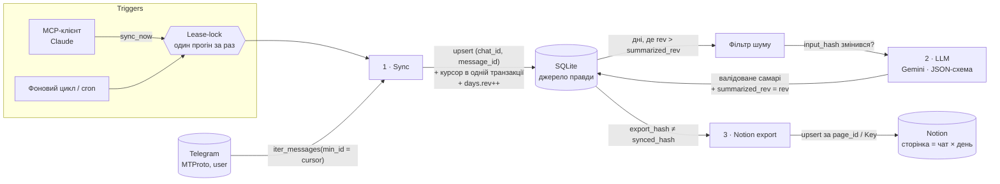

# Telegram MCP-конектор для «другого мозку»

MCP-сервер підключається до Telegram (групи та особисті чати) від імені користувача. Він **інкрементально** забирає нові повідомлення, за допомогою LLM робить **короткі денні самарі** без шуму і публікує їх у **Notion**. Повторні, пропущені й подвійні запуски безпечні: дублів не буде, повідомлення не загубляться.

```
Telegram ──(тільки id > курсор)──► SQLite ──(змінені дні)──► фільтр шуму ──► LLM (JSON-схема) ──► SQLite ──(змінені самарі)──► Notion
```

---

## Зміст
1. [Що вміє](#що-вміє)
2. [Запуск крок за кроком](#запуск-крок-за-кроком)
3. [Розгортання на сервері (24/7)](#розгортання-на-сервері-247)
4. [Схема потоку даних](#схема-потоку-даних)
5. [Ядро синхронізації: чому немає дублів і пропусків](#ядро-синхронізації-чому-немає-дублів-і-пропусків)
6. [LLM-самарі та відсів шуму](#llm-самарі-та-відсів-шуму)
7. [Секрети та чутливі дані](#секрети-та-чутливі-дані)
8. [Рішення та trade-offs](#рішення-та-trade-offs)
9. [Обмеження](#обмеження)
10. [Тести та демо](#тести-та-демо)
11. [Структура проєкту](#структура-проєкту)

---

## Що вміє

**MCP-інструменти** (stdio-транспорт, працює з Claude Desktop / Claude Code / будь-яким MCP-клієнтом):

| Інструмент | Що робить |
|---|---|
| `tg_list_chats(query?, limit?)` | список чатів (DM, групи, канали) з id; позначає, які відстежуються |
| `tg_read_messages(chat_id, limit?)` | останні повідомлення чату напряму з Telegram |
| `tg_send_message(chat_id, text)` | надіслати повідомлення (за замовчуванням лише у відстежувані чати; вимикається `READ_ONLY=true`) |
| `tg_track_chat(chat_id, include_history?)` / `tg_untrack_chat(chat_id)` | вибір чатів для синхронізації (нічого не синхронізується без явного вибору). `include_history=false` підключає чат «з цього моменту»: його історія ніколи не читається |
| `sync_now()` | синхронізація → самарі → Notion; ідемпотентно, повертає звіт прогону |
| `sync_status()` | курсори, помилки, черга днів, останні прогони, розклад |
| `get_summaries(chat_id?, date_from?, date_to?)` | збережені денні самарі |

**Періодичність:** поки MCP-сервер запущений, фоновий цикл робить прогін одразу після старту (догоняє все пропущене) і далі кожні `SYNC_INTERVAL_MINUTES`. Незалежно від Claude те саме робить `uv run tg-connector sync` з cron/launchd. Обидва способи можна вмикати одночасно: їх розводить спільне блокування.

**CLI** (`uv run tg-connector …`): `login`, `check`, `chats`, `track`, `untrack`, `sync`, `status`, `summaries`, `serve`.

---

## Запуск крок за кроком

### 0. Що потрібно
- macOS / Linux, [uv](https://docs.astral.sh/uv/) (сам встановить Python 3.12).
- Акаунт Telegram, Google-акаунт (Gemini), робочий простір Notion.

```bash
git clone https://github.com/mitnikovaola-afk/telegram-mcp-connector.git && cd telegram-mcp-connector
uv sync
cp .env.example .env && chmod 600 .env
```

### 1. Ключі (вставляються лише у `.env`)
| Змінна | Де взяти |
|---|---|
| `TG_API_ID`, `TG_API_HASH` | [my.telegram.org](https://my.telegram.org) → *API development tools* → створити застосунок |
| `GEMINI_API_KEY` | [aistudio.google.com](https://aistudio.google.com) → *Get API key* → *Create API key*. Безкоштовний тариф, billing **не** підключати |
| `NOTION_TOKEN` | [notion.so/profile/integrations](https://www.notion.so/profile/integrations) → *New integration* (Internal) → *Internal Integration Secret* |
| `NOTION_PARENT_PAGE_ID` | посилання на сторінку, де зʼявиться база самарі. На сторінці: **••• → Connections → ваша інтеграція** |

### 2. Вхід у Telegram (один раз, інтерактивно)
```bash
uv run tg-connector login      # телефон → код з Telegram → (пароль 2FA, якщо є)
uv run tg-connector check      # перевіряє Telegram, Gemini (і що модель доступна), Notion
```

### 3. Вибір чатів і перший прогін
```bash
uv run tg-connector chats -q маркет          # знайти id чату
uv run tg-connector track -1001234567890 42  # групу та DM (з історією за BACKFILL_DAYS)
uv run tg-connector track 42 --from-now      # або без історії: лише повідомлення, написані після цієї команди
uv run tg-connector sync                     # синхронізація → самарі → Notion
uv run tg-connector sync                     # повтор: 0 нових, 0 LLM-викликів, 0 змін у Notion
```
Під час першого прогону Notion-база «Telegram — денні самарі» створюється сама: одна сторінка на пару «чат + день».

### 4. Підключення до Claude
**Claude Desktop** → *Settings → Developer → Edit Config* (`claude_desktop_config.json`):
```json
{
  "mcpServers": {
    "telegram": {
      "command": "/Users/<you>/.local/bin/uv",
      "args": ["--directory", "/absolute/path/to/telegram-mcp-connector", "run", "tg-connector", "serve"]
    }
  }
}
```
**Claude Code:**
```bash
claude mcp add telegram -- uv --directory /absolute/path/to/telegram-mcp-connector run tg-connector serve
```
Приклади запитів: *«Покажи мої чати з "маркет"»*, *«Відстежуй цей чат»*, *«Синхронізуй і покажи самарі за вчора»*.

### 5. (Опційно) синхронізація без відкритого Claude
```bash
# crontab -e
*/30 * * * * cd /absolute/path/to/telegram-mcp-connector && ~/.local/bin/uv run tg-connector sync >> data/logs/cron.log 2>&1
```
Cron на ноутбуці працює, лише поки компʼютер увімкнений і не спить. Для синхронізації 24/7 див. [Розгортання на сервері](#розгортання-на-сервері-247).

---

## Розгортання на сервері (24/7)

За замовчуванням конектор працює локально. Але і фоновий цикл MCP-сервера, і cron/launchd на ноутбуці працюють, лише поки компʼютер увімкнений і не спить. Пропущене не губиться: наступний прогін забере все після курсора. Проте самарі зʼявляться лише тоді, коли компʼютер знову ввімкнуть. Щоб самарі оновлювалися цілодобово, синхронізацію можна винести на невеликий сервер (VPS). Цей варіант описаний нижче, але для тестового не розгорнутий.

**Що переносити.** Лише синхронізацію: `tg-connector sync` за розкладом. Notion і так у хмарі, тож самарі доступні звідусіль. MCP-інструменти для Claude лишаються локальними (stdio), про віддалений MCP див. [нижче](#віддалений-mcp-не-реалізовано).

**Вартість.** Telegram, Notion і безкоштовний тариф Gemini коштують 0 $. Платити доведеться лише за сервер, і вистачить найменшого (1 vCPU, 1 ГБ RAM): орієнтовно 4–6 € на місяць у типових VPS-хостерів або 0 $ на безкоштовних тарифах великих хмар (Oracle Cloud Free Tier, Google Cloud Free Tier; для реєстрації зазвичай потрібна банківська картка). Ціни змінюються, тож перевіряйте їх перед вибором.

### Кроки (Ubuntu 24.04)

**1. Сервер і код.** Вхід на сервер лише за SSH-ключем. Конектор працює від окремого користувача без sudo, а файли systemd (крок 4) створює адміністратор.
```bash
curl -LsSf https://astral.sh/uv/install.sh | sh
git clone <repo-url> ~/telegram-mcp-connector && cd ~/telegram-mcp-connector
uv sync
mkdir -m 700 data
```

**2. Секрети й стан.** Спершу зупиніть локальну синхронізацію: закоментуйте рядок у crontab і закрийте Claude з MCP-сервером. Потім на локальній машині зробіть цілісну копію бази (вона працює в режимі WAL, тому простого копіювання файлу недостатньо) і перенесіть її разом із `.env` через `scp`, а не через git чи месенджер. База потрібна, щоб сервер продовжив з тих самих курсорів і не обробляв історію заново.
```bash
sqlite3 data/connector.db "VACUUM INTO 'data/connector-transfer.db'"
scp .env <user>@<server>:~/telegram-mcp-connector/.env
scp data/connector-transfer.db <user>@<server>:~/telegram-mcp-connector/data/connector.db
ssh <user>@<server> 'cd ~/telegram-mcp-connector && chmod 600 .env data/connector.db'
rm data/connector-transfer.db
```

**3. Вхід у Telegram заново, на сервері.** Не копіюйте `data/telegram.session`: Telegram може відкликати сесію, яка працює одночасно з двох IP (`AUTH_KEY_DUPLICATED`). Окремий вхід створює окремий пристрій у *Налаштування → Пристрої*, і його можна завершити незалежно від локального.
```bash
uv run tg-connector login
uv run tg-connector check    # покаже, зокрема, якщо Gemini недоступний з регіону сервера
uv run tg-connector status   # відстежувані чати й курсори з перенесеної бази
```

**4. Розклад через systemd.** Таймер переживає перезавантаження, а логи йдуть у journald. Замініть `<user>` на користувача з кроку 1.

`/etc/systemd/system/tg-connector-sync.service`:
```ini
[Unit]
Description=Telegram connector: sync, summaries, Notion
Wants=network-online.target
After=network-online.target

[Service]
Type=oneshot
User=<user>
WorkingDirectory=/home/<user>/telegram-mcp-connector
ExecStart=/home/<user>/.local/bin/uv run tg-connector sync
```

`/etc/systemd/system/tg-connector-sync.timer`:
```ini
[Unit]
Description=Telegram connector sync every 30 minutes

[Timer]
OnCalendar=*:0/30
Persistent=true

[Install]
WantedBy=timers.target
```

```bash
sudo systemctl daemon-reload
sudo systemctl enable --now tg-connector-sync.timer
systemctl list-timers tg-connector-sync.timer   # коли наступний прогін
journalctl -u tg-connector-sync -n 50           # лог останніх прогонів
```
Якщо прогін затягнеться довше за 30 хвилин, systemd не запустить другий екземпляр, а lease-lock у базі страхує додатково.

**5. Синхронізація лише в одному місці.** Після переносу локально поставте `SYNC_INTERVAL_MINUTES=0` у `.env` і не вмикайте cron. Локальний MCP-сервер можна й далі використовувати для перегляду чатів і надсилання повідомлень, але його `sync_status` і `get_summaries` показуватимуть стару локальну базу. Актуальні самарі лежать у Notion. Якщо дві бази все ж синхронізуватимуть ті самі чати, дублів у Notion не буде (сторінка шукається за ключем «чат + день»), але квота Gemini витрачатиметься вдвічі.

### Безпека на сервері

- **`data/telegram.session` дає повний доступ до акаунта Telegram.** На сервері: права `600`, шифрування диска, якщо хостер його підтримує, і жодних резервних копій у відкритому вигляді. Якщо сервер скомпрометовано, завершіть сесію в *Налаштування → Пристрої* і перевипустіть `GEMINI_API_KEY` та `NOTION_TOKEN`.
- **Вхідні порти не потрібні:** конектор лише сам звертається до Telegram, Gemini і Notion. У firewall відкритий тільки SSH.
- **Вхід з IP дата-центру Telegram може сприйняти насторожено:** прийде сповіщення про новий пристрій, зрідка можливі обмеження акаунта. Тому не варто часто змінювати сервер чи IP.

### Віддалений MCP (не реалізовано)

Щоб Claude підключався до інструментів на сервері напряму, потрібні HTTP-транспорт MCP (Streamable HTTP) замість stdio, HTTPS і автентифікація (OAuth або токен). Без автентифікації будь-хто, хто знайде адресу, зможе читати й надсилати повідомлення від імені власника акаунта. Для тестового це свідомо не робилося: синхронізація 24/7 працює й без цього, а відкритий в інтернет ендпоінт суттєво розширює поверхню атаки.

---

## Схема потоку даних



Кожен етап ідемпотентний і зберігає свій стан окремо. Тому прогін можна перервати будь-де: наступний продовжить з того самого місця.

---

## Ядро синхронізації: чому немає дублів і пропусків

| Сценарій | Механізм | Тест |
|---|---|---|
| **Повторний запуск** | повідомлення мають ключ `(chat_id, message_id)`; Telegram питаємо лише про `id > cursor` | `test_rerun_creates_no_duplicates_and_calls_nothing` |
| **Пропущені запуски** (сервер був вимкнений) | курсор не залежить від часу: наступний прогін забирає все після курсора, скільки б днів не минуло | `test_missed_runs_catch_up_everything` |
| **Падіння посеред синхронізації** | батч повідомлень і зсув курсора записуються в **одній транзакції**; курсор лише зростає (`MAX`) | `test_crash_mid_sync_resumes_without_loss_or_duplicates` |
| **Подвійний / паралельний запуск** (MCP + cron + ручний) | lease-lock у SQLite (`BEGIN IMMEDIATE`); другий прогін отримує `skipped` | `test_concurrent_run_is_skipped` |
| **Процес помер і не зняв lock** | у lock є TTL, його продовжує heartbeat; прострочений lock перехоплюється | `test_stale_lock_from_crashed_process_is_taken_over` |
| **Редагування повідомлення** | перечитується вікно `EDIT_LOOKBACK_HOURS`; змінений `content_hash` позначає день як «брудний» | `test_edited_message_resummarizes_its_day` |
| **LLM недоступна / 429 / таймаут** | день лишається в черзі, інші дні не губляться; наступний прогін повторює. Тимчасові помилки **не витрачають** ліміт спроб, тож навіть багатогодинний збій не «ховає» день назавжди | `test_llm_outage_keeps_day_queued_and_recovers`, `test_day_long_quota_outage_never_exhausts_attempts` |
| **Вичерпана добова квота LLM** (429 «retry in 15h») | LLM ставиться на паузу до скидання квоти: прогони не чекають марно (≈1 с), Telegram синхронізується далі, дні чекають у черзі | `test_daily_quota_pauses_llm_calls_until_reset` |
| **Особистий чат без історії** (`--from-now`) | курсор і «підлога» ставляться на останнє повідомлення; нічого нижче підлоги не зберігається й не йде в LLM, навіть через перечитування правок | `test_track_from_now_never_reads_existing_history` |
| **Падіння після створення сторінки в Notion** | `page_id` зберігається локально; якщо не встиг зберегтися, сторінку знаходимо за унікальним `Key = chat_id:date` | `test_notion_crash_after_page_creation_does_not_duplicate` |

**Інкрементальність на трьох рівнях:**
1. **Telegram** — читаємо лише нове (`min_id`). Перший прогін обмежений `BACKFILL_DAYS`.
2. **LLM** — обробляються лише дні, де `rev > summarized_rev`. Якщо після фільтра вхід байт-у-байт той самий (`input_hash`), LLM не викликається зовсім.
3. **Notion** — сторінка оновлюється, лише коли змінилося те, що на ній показано (`export_hash`).

`rev`/`summarized_rev` захищає від гонки: якщо поки писалося самарі, у день прийшло нове повідомлення, день лишається «брудним» і обробиться наступним прогоном.

Свідомо обрано *at-least-once читання + ідемпотентний запис* замість обіцянки exactly-once: повторне читання дешеве й безпечне, а гарантію дає ключ і транзакція, а не «вдача».

---

## LLM-самарі та відсів шуму

1. **Детермінований фільтр до LLM** (`noise.py`): службові повідомлення, стікери, GIF, голосові та відеокружки, медіа без підпису, лише емодзі, «дякую/спс/ахаха». Фільтр **консервативний**: «ок», «так», «+» залишаються, бо можуть бути згодою на рішення. Шум зберігається в БД (синхронізація повна), але не йде в LLM.
2. **Формат даних для моделі:** `[10:05] Олег (reply to Аня 10:02): …`.
   - Медіа позначені тегами `[photo]`, `[file: …]`, `[poll]`, переслане позначене як `[forwarded from X, originally 20.11 17:55]` (дата оригіналу потрібна, щоб «завтра» в пересланому рахувалось правильно).
   - Відповідь на повідомлення з іншого дня приходить з цитатою: `(reply to Олег, 19.11 23:55: «…»)`.
   - У заголовку є дата з днем тижня, тож «до понеділка» перетворюється на «понеділок, 23.11».
   - Секрети замасковані.
3. **Жорстка JSON-схема:** `has_signal`, `tldr`, `facts` (ключові факти й цифри), `topics`, `decisions`, `action_items{task, owner, due}`, `open_questions`. Відповідь валідується pydantic. Якщо не підходить, модель отримує текст помилки і відповідає ще раз (до 2 разів). Списки обрізаються до 5 пунктів.
4. **Правила промпту:**
   - коротко; нічого не вигадувати (owner/due = null, якщо не названі);
   - пізніші повідомлення важливіші: у самарі лише фінальна версія рішення, виконавця чи дедлайну;
   - сарказм і «може колись» не є рішеннями, а «+» означає згоду;
   - «я/ти» замінюються на імена;
   - цифри копіюються точно;
   - день без робочого змісту → `has_signal=false`;
   - мова самарі = мова більшості повідомлень. Її визначає код (за літерами і/ї/є/ґ, ы/э/ъ/ё та латиницею) і явно передає моделі. Якщо у відповіді українською трапились російські літери або в англійській кирилиця, модель один раз переписує відповідь.
5. **Захист від prompt injection:** переписка передається як дані між `<chat_log>…</chat_log>`. Спроби «закрити» тег у тексті вирізаються, а системний промпт прямо забороняє виконувати інструкції з логу.
6. **Посилання** витягуються регуляркою, а не моделлю, тому не можуть бути вигадані.
7. **Довгі дні** (> `MAX_CHARS_PER_LLM_CALL`) діляться на частини, які потім зливаються окремим викликом (map-reduce). Нічого не обрізається мовчки.
8. **День, що триває**, отримує статус «День триває» і оновлюється на місці. Наступного дня статус змінюється на «Підсумок дня» без нового LLM-виклику.
9. **Дні без сигналу** не створюють порожніх сторінок у Notion.

---

## Секрети та чутливі дані

- Усі ключі лежать лише в `.env` (у `.gitignore`, `chmod 600`), у репозиторії тільки `.env.example`.
- **Файл сесії Telegram = повний доступ до акаунта.** Він зберігається в `data/telegram.session` з правами `600`, поза git, і зареєстрований як секрет.
- **Логи:** фільтр замінює будь-яке значення секрету на `***` у кожному рядку логу, навіть якщо ключ потрапив у текст винятку бібліотеки. Логи пишуться в stderr (stdout зайнятий протоколом MCP) і в `data/logs/` з правами `600`.
- **Секрети з переписки не йдуть у LLM:** паролі, номери карток, IBAN, ключі API, токени в посиланнях і одноразові коди маскуються до відправки в модель (`redact.py`), тому їх немає ні в самарі, ні в Notion. Оригінал лишається лише в локальній БД.
- **Мінімізація даних:** синхронізуються лише явно обрані чати (`track`). Особистий чат можна підключити без історії (`--from-now`). У LLM іде лише відфільтрований текст одного дня одного чату. БД (`data/connector.db`) має права `600`.
- **Надсилання повідомлень:** лише у відстежувані чати (`SEND_ONLY_TRACKED`), повністю вимикається `READ_ONLY=true`. MCP-клієнт питає дозвіл перед викликом інструмента, а в описі інструмента моделі прямо сказано погодити текст із користувачем.
- **Gemini free tier:** Google може використовувати дані безкоштовного тарифу для покращення моделей, тому демо проганялося на тестових чатах. Для реальної робочої переписки потрібен платний тариф або інший провайдер (див. trade-offs).

---

## Рішення та trade-offs

| Рішення | Чому | Ціна / альтернатива |
|---|---|---|
| **MTProto (Telethon) від імені користувача**, не Bot API | лише так видно особисті чати й історію груп; бот бачить тільки те, що надіслали йому, і лише після додавання | ризик обмежень акаунта за автоматизацію: працюємо тільки читанням, паузи, повага до FLOOD_WAIT. Telegram Business-бот дає лише DM без груп |
| **Pull за курсором**, а не live-оновлення | пропущені й повторні запуски безпечні за побудовою; не потрібен процес, що працює 24/7 | затримка = інтервал синхронізації; видалення повідомлень не відстежуються |
| **SQLite як джерело правди + Notion як вітрина** | транзакції, унікальні ключі й курсори, яких Notion не дає; Notion зручний для читання людиною | два сховища; у Notion лише проєкція |
| **Gemini (free tier)** за інтерфейсом `LLMClient` | 0 $ для тестового; JSON-схема з коробки; довгий контекст | дані free tier можуть використовуватись Google. Заміна на Claude / локальну модель — один клас у `llm.py` |
| **LLM на боці сервера**, не через MCP sampling | sampling не підтримується в Claude Code і позначений deprecated у специфікації MCP 2026-07-28; самарі мають робитися за розкладом без клієнта | потрібен окремий API-ключ |
| **Хеш входу перед LLM-викликом** | повторні прогони не витрачають квоту й не «перемішують» самарі через недетермінованість LLM | зміна промпту не перераховує старі дні автоматично (`PROMPT_VERSION` у хеші спрацює при наступній зміні дня) |
| **Консервативний фільтр шуму** | не губимо «ок» як згоду | трохи більше токенів у LLM |
| **stdio-транспорт** | локальний персональний сервер, секрети не виходять з машини, OAuth не потрібен | один користувач на інсталяцію |
| **Локальний запуск за замовчуванням**, сервер опційно | 0 $; сесія Telegram і ключі не залишають компʼютер | самарі оновлюються, лише поки компʼютер увімкнений; для 24/7 потрібен VPS ([розгортання](#розгортання-на-сервері-247)) |
| **Python** | Telethon — найзріліша MTProto-бібліотека; офіційні SDK MCP, Gemini, Notion | — |

---

## Обмеження

- Голосові та відеокружки не транскрибуються (вважаються шумом), вміст фото/файлів не аналізується, береться лише підпис і назва файлу.
- **Видалення й редагування** підхоплюються лише у вікні `EDIT_LOOKBACK_HOURS` (за замовчуванням 24 год); старші зміни pull-модель не бачить.
- Теми (topics) у форум-групах зливаються в одне самарі дня; перейменування чату не оновлює назву в Notion до повторного `track`.
- Повний перелік пограничних випадків і як кожен перевірено: [`docs/edge-cases.md`](docs/edge-cases.md).
- **Локально розклад працює, лише поки компʼютер увімкнений і не спить:** фоновий цикл потребує запущеного MCP-сервера, а cron/launchd — увімкненої машини. Пропущене не губиться, бо наступний прогін забере все після курсора, але самарі зʼявляться із затримкою. Для 24/7 див. [Розгортання на сервері](#розгортання-на-сервері-247).
- Перший прогін нового чату бере лише `BACKFILL_DAYS` днів історії.
- Межі «дня» рахуються в одному часовому поясі (`TIMEZONE`).
- **Безкоштовний Gemini: 20 запитів на добу на модель** (так відповідав API під час демо) і затримка 8–90 с на виклик у години пікового навантаження. Під час 429 дні чекають у черзі й обробляються після скидання квоти (див. [`docs/demo.md`](docs/demo.md)). Для щоденного використання на кількох активних чатах варто:
  - або поставити `SUMMARIZE_TODAY=false`: тоді 1 виклик на чат за день, самарі лише завершених днів;
  - або взяти платний тариф чи інший провайдер.
- Модель зрідка може вставити слово іншою мовою (спостерігалось у режимі `GEMINI_THINKING_LEVEL=low`, тому за замовчуванням використовується стандартний режим моделі).
- Один користувач / один Telegram-акаунт на інсталяцію. Telegram може обмежити акаунт, якщо його автоматизацію сприйме як спам; конектор лише читає й пише тільки за явним запитом.
- Notion обмежує швидкість (~3 запити/с): вивантаження великої історії займає час. Ретраї з `Retry-After` вбудовані в SDK.

---

## Тести та демо

```bash
uv run pytest -q
```
Тести проганяють увесь пайплайн із фейковими Telegram, LLM і Notion:
- повтори, пропуски, падіння, паралельність;
- редагування й видалення, перетворення групи на супергрупу, втрата доступу до чату, довгі дні;
- збої та квота LLM, невалідний JSON, prompt injection;
- маскування секретів, відповіді через північ, голосові;
- фінальний статус дня, ідемпотентність Notion.

Деталі: таблиця вище та [`docs/edge-cases.md`](docs/edge-cases.md).

**Якість самарі на справжній моделі** перевіряє eval: 17 змодельованих діалогів, зокрема:
- скасоване рішення, передана задача;
- сарказм, prompt injection, паролі в чаті;
- змішані мови, «я/ти» замість імен, відносні дедлайни.

Кожен діалог має автоматичні перевірки:
```bash
uv run python evals/run_eval.py                # модель з .env; 1 LLM-виклик на сценарій
```
Звіти лежать у [`evals/results/`](evals/results/).

**Демо на реальних чатах:** див. [`docs/demo.md`](docs/demo.md). Там лог прогонів на двох групах і особистому чаті:
- перший прогін і повторний без дублів;
- одне нове повідомлення, правка, подвійний запуск;
- вичерпана квота LLM і відновлення після неї;
- виклики інструментів через справжній MCP-клієнт.

---

## Структура проєкту

```
src/tg_connector/
  config.py           налаштування з .env
  logging_setup.py    логи + маскування секретів
  models.py           спільні типи даних
  db.py               SQLite: схема, транзакції, курсори, lock
  telegram_source.py  Telethon: чати, нові повідомлення, надсилання
  noise.py            фільтр шуму, хеші, посилання
  redact.py           маскування секретів перед LLM
  sync.py             етап 1 — інкрементальна синхронізація
  llm.py              провайдер LLM (Gemini)
  summarizer.py       етап 2 — денні самарі
  notion_sink.py      етап 3 — публікація в Notion
  pipeline.py         оркестрація + статус
  server.py           MCP-сервер + фоновий розклад
  cli.py              командний рядок
tests/                end-to-end тести пайплайна та edge cases
evals/                змодельовані діалоги + перевірки якості самарі на справжній моделі
docs/                 демо-лог і перелік edge cases
```
